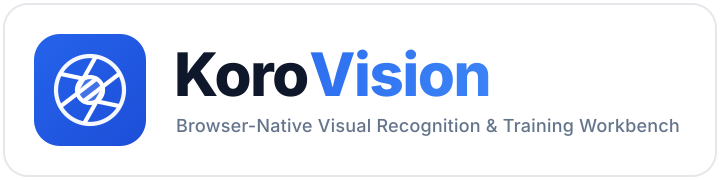
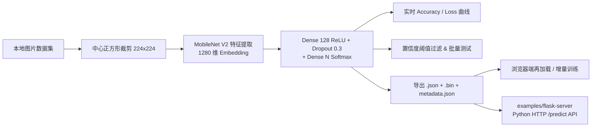

<div align="center">
  
  <h1>KoroVision</h1>
  <p><strong>基于 TensorFlow.js + MobileNet V2 + Dense 的浏览器端零代码视觉识别与训练平台</strong></p>
  <p>
    
    
    
    
  </p>
</div>

---

**KoroVision** 是面向轻量图像分类场景打造的**浏览器端零代码视觉模型训练与验证工作台**，，用于解决小样本图像识别任务中“环境配置繁琐、训练黑盒不可见、导出模型难以对接业务端”的痛点。

整个平台以**单文件纯静态网页**（[`index.html`](index.html)）形态运行，借助浏览器端 WebGL 加速完成特征提取、迁移学习、评估测试与模型导出，**所有训练图片均留在本地浏览器内存中，不上传至任何远程服务器**。

---

## 核心特性

- **零安装开箱即用**：基于 TensorFlow.js 4.20 与 MobileNet V2（1280 维特征向量），开启 GitHub Pages 或本地浏览器即可训练。
- **隐私优先本地计算**：图像解码、特征提取与反向传播全部在用户本地 GPU/WebGL 中完成。
- **动态类别与样本管理**：自由增删类别、拖拽批量上传图片、展开网格管理或删除单张样本。
- **分层划分与实时可视化**：按类别分层划分训练集与验证集，实时绘制训练准确率、验证准确率与损失曲线，支持导出 PNG 曲线图。
- **置信度门槛与批量测试**：支持单张/多张批量识别，通过滑块实时调节置信度阈值（默认 70%），拦截类别外误判并标示「无法确定」。
- **模型导入导出与增量微调**：一键导出标准 TF.js 格式（`korovision-model.json` + `korovision-model.weights.bin` + `metadata.json`）；重新导入后可切换「增量训练」模式，**保留隐藏层与已有类别输出权重**进行低学习率（`0.0002`）微调。
- **内置落地案例模型**：一键加载源自 ZumiaoLens 项目的三分类模型，直接验证端到端推理效果。

---

## 技术架构



---

## 内置示例模型（Showcase Demo：`demo-model/`）

仓库内置了来自 **ZumiaoLens（佛山祖庙建筑装饰识别）** 案例的预训练三分类模型（约 650 KB），可用于开箱测试或 Flask API 部署：

| 指标 | 说明 |
| :--- | :--- |
| 模型架构 | `MobileNetV2 (1280-dim) + Dense(128, relu) + Dropout(0.3) + Dense(3, softmax)` |
| 识别类别 | `独角狮`（28 张）、`其他狮子`（17 张）、`其他物品`（29 张） |
| 样本总量 | 74 张（分层验证集） |
| 训练轮数 | 20 Epochs |
| 最佳验证准确率 | **90.9%** |
| 模型文件 | [`demo-model/zumiao-model.json`](demo-model/zumiao-model.json)、[`demo-model/zumiao-model.weights.bin`](demo-model/zumiao-model.weights.bin)、[`demo-model/metadata.json`](demo-model/metadata.json) |

---

## 快速开始

### 方式一：GitHub Pages 在线部署（推荐）

将本仓库推送到 GitHub 后，在仓库页面进入 **Settings → Pages**：
1. **Source** 选择 `Deploy from a branch`；
2. **Branch** 选择 `main` 与 `/ (root)`，保存后等待约 1 分钟；
3. 打开生成的 Pages 链接即可在线训练自定义视觉模型，或点击「**一键加载内置示例模型**」立即体验。

### 方式二：本地运行

为了避免浏览器 `file://` 协议限制 `fetch('./demo-model/...')`，推荐使用任意本地静态 HTTP 服务启动：

```bash
git clone <your-repo-url>
cd KoroVision
python -m http.server 8000
```

随后在浏览器访问 `http://localhost:8000` 即可。
（若直接双击打开 `index.html`，仍可通过页面上的「选择模型文件」按钮手动选中 `demo-model/` 内的 3 个文件。）

### 方式三：对接 Python Flask 推理后端（可选）

如果需要将浏览器训练导出的模型接入小程序、App 或 **KoroFlow** 等后端工作流，可参考 [`examples/flask-server/`](examples/flask-server/) 中的完整示例与 [`DEPLOY.md`](examples/flask-server/DEPLOY.md)：

```bash
cd examples/flask-server
pip install -r requirements.txt
python server.py
```

---

## 目录结构

```text
KoroVision/
├── index.html                    # 单文件图像识别训练与测试平台（GitHub Pages 入口）
├── README.md                     # 项目说明文档
├── LICENSE                       # MIT 开源协议
├── .gitignore
├── assets/
│   └── korovision-logo.svg       # KoroVision 项目矢量标识
├── demo-model/                   # 内置示例模型（ZumiaoLens 独角狮三分类，~650 KB）
│   ├── zumiao-model.json
│   ├── zumiao-model.weights.bin
│   └── metadata.json
└── examples/
    └── flask-server/             # Python Flask + Keras 推理后端示例
        ├── server.py
        ├── flask_app.py
        ├── requirements.txt
        └── DEPLOY.md
```
